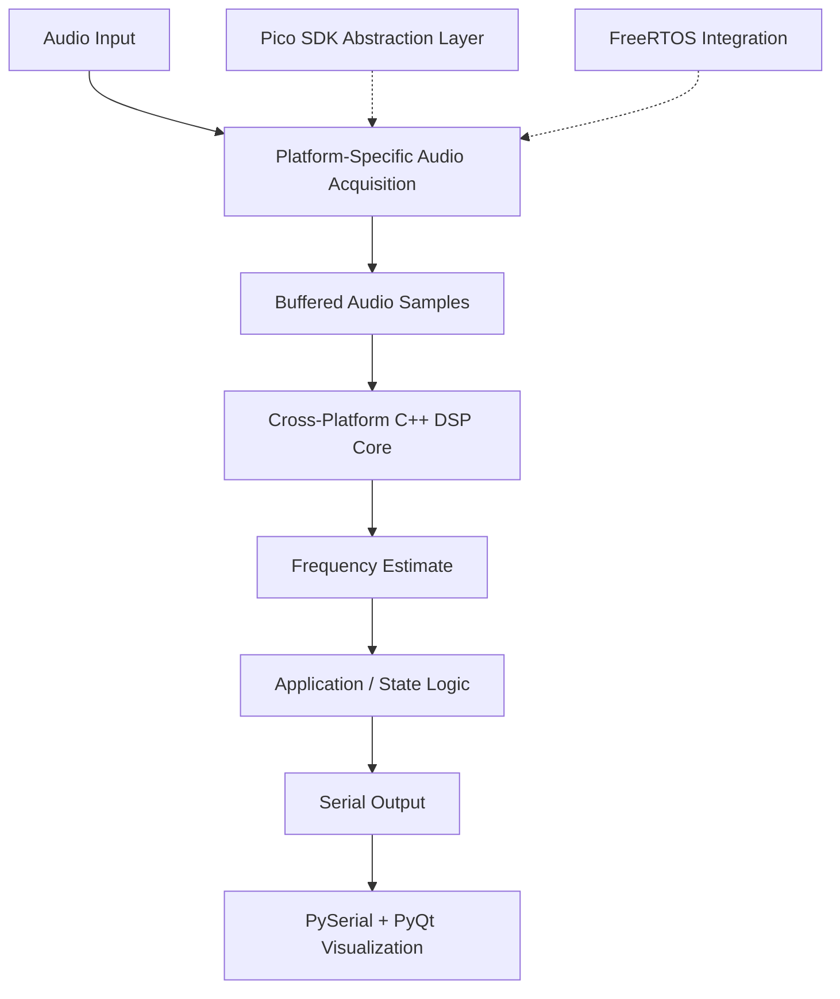

# Cross-Platform Embedded Voice Analyzer

A modular, real-time voice frequency analyzer written in modern C++ for embedded systems.

This project builds on the DSP implementation from [JoseMartel/audio-freq-estimator-rp2350](https://github.com/JoseMartel/audio-freq-estimator-rp2350), extracting the ARM DSP logic into a reusable, cross-platform C++ component. The implementation emphasizes static memory allocation, compile-time interfaces (using C++20 concepts), and separation between signal processing, hardware access, and application logic.

The project currently includes a multicore baremetal Raspberry Pi RP2350 example and a FreeRTOS-based example.

## Features

- **Reusable DSP core:** Frequency estimation logic extracted into a modular C++ class.
- **Modern C++:** Uses C++ concepts to express hardware and processing interfaces at compile time.
- **Static memory allocation:** Designed to avoid dynamic allocation.
- **Platform-independent DSP:** Separates signal-processing logic from platform-specific hardware access.
- **Multicore processing:** RP2350 example with UI and application state handling on one core and double-buffered DSP processing on the other.
- **RTOS integration:** Includes a basic FreeRTOS example.
- **Modular hardware abstraction:** A Pico SDK abstraction layer inspired by Rust Embassy, intended to be extracted into a separate project.

<!-- ## Demo

<!-- Replace this placeholder with a link to the demo video once available. -->

*Video demonstration coming soon.*

The planned demonstration uses a Python application built with PySerial and PyQt to display the estimated voice frequency in real time. -->

<!-- Suggested: embed a short, compressed MP4 or an animated preview here. -->

## Architecture

The project separates the frequency-estimation algorithm from hardware-specific code and application-level behavior.

The exact acquisition and scheduling paths depend on the selected platform and example.

### DSP core

The DSP implementation is isolated in a C++ class, providing a clear boundary between the algorithm and its execution environment.

The design aims to make the processing logic reusable without coupling it to a particular RTOS, board-support package, or application architecture.

C++ concepts provide compile-time constraints on the interfaces used by the implementation, avoiding the need for runtime polymorphism in those interfaces.

### RP2350 multicore example

The RP2350 example separates application responsibilities across the two cores:

- **Core 0:** UI handling, application states, and coordination.
- **Core 1:** Double-buffered audio processing and frequency estimation.

This separation allows the application to remain responsive while DSP work is performed independently.

The double-buffering scheme separates audio acquisition from processing and provides a foundation for predictable real-time execution.

### FreeRTOS example

A separate example demonstrates how the DSP component can be integrated into a FreeRTOS application.

This provides a contrasting execution model and helps demonstrate that the DSP logic is not inherently tied to the RP2350 multicore architecture.

## Design Principles

### Static allocation

Memory usage is designed around statically allocated objects and buffers rather than dynamic allocation during normal operation.

This makes resource ownership more explicit and helps keep the real-time processing path predictable.

### Compile-time interfaces

The hardware-facing interfaces use modern C++ techniques, including concepts, to express requirements on the types supplied to the DSP and platform integration layers.

Where applicable, these interfaces allow the compiler to validate compatibility without introducing virtual dispatch.

### Separation of concerns

The project is organized around three responsibilities:

- **Signal processing:** Frequency-estimation logic and its associated state.
- **Platform integration:** Audio acquisition, buffering, synchronization, and hardware access.
- **Application logic:** UI, application states, and reporting the estimated frequency.

This separation is intended to make the DSP core easier to reuse and the platform integrations easier to maintain.

## Pico SDK Abstraction Layer

The project also contains a C++ abstraction layer for the Raspberry Pi Pico SDK, inspired by the design philosophy of [Rust Embassy](https://github.com/embassy-rs/embassy).

The goal is to provide clearer, more modular interfaces for embedded development while retaining access to the underlying hardware capabilities.

This layer is currently part of the repository and is intended to become an independent project with its own repository and dependency structure.

It should be considered a work in progress until that extraction is complete.

## Repository Structure

The repository contains the DSP implementation, platform-specific integration code, and example applications.

The exact directory structure may evolve as the hardware abstraction layer is separated into its own project.

<!-- Add a directory tree here once the repository layout is finalized. -->

<!-- ## Building and Running

Build instructions are currently platform-specific.

Refer to the relevant example and its build configuration for the required toolchain, SDK, and dependencies. -->

<!-- TODO:
- Document the RP2350 toolchain and Pico SDK requirements.
- Add configure, build, and flash commands.
- Document the FreeRTOS toolchain and target configuration.
- Describe the audio hardware, pin assignments, and serial protocol.
-->

<!-- ## Roadmap

- [ ] Finalize and document the public DSP interface.
- [ ] Document the RP2350 multicore synchronization and double-buffering design.
- [ ] Expand the FreeRTOS example and its build instructions.
- [ ] Extract the Pico SDK C++ abstraction layer into a standalone repository.
- [ ] Add the PySerial/PyQt real-time visualization demo.
- [ ] Document supported hardware, audio input configuration, and measured processing performance. -->

## Acknowledgements

This project is based on the DSP implementation developed by **Jose Martel**:

- Original repository: [JoseMartel/audio-freq-estimator-rp2350](https://github.com/JoseMartel/audio-freq-estimator-rp2350)

The original project provides the foundation for the audio frequency-estimation and ARM DSP logic. This repository adapts that work into a cross-platform C++ architecture, emphasizing static allocation, compile-time interfaces, modular hardware abstractions, and integration with different embedded execution models.

Please refer to the original repository for its license and attribution requirements. The applicable license and notices should be preserved when redistributing or modifying the original implementation.

<!-- ## License -->

<!-- TODO: Specify this repository's license and clarify how it relates to the upstream project's license. -->

